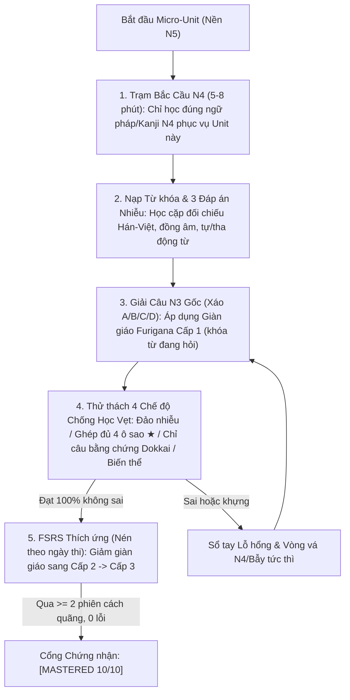
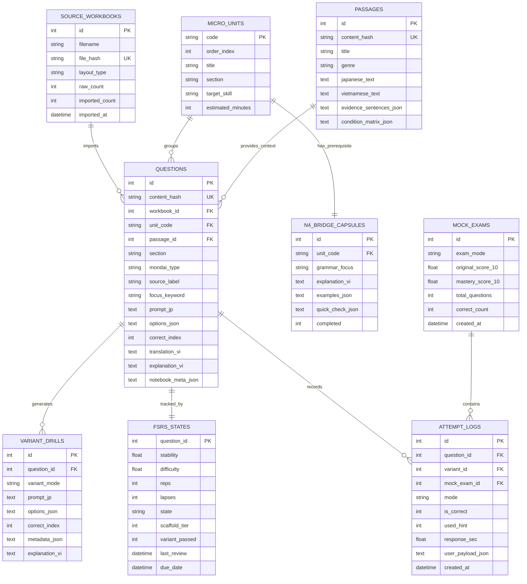

# BẢN NGHIÊN CỨU PHƯƠNG PHÁP SƯ PHẠM & KIẾN TRÚC HỆ THỐNG CHINH PHỤC 10/10 JLPT N3

> [!NOTE]
> Tài liệu này là **Nguồn chân lý duy nhất (Single Source of Truth)** cho Giai đoạn 2 (Triển khai hệ thống). Toàn bộ số liệu về 7 tệp Excel được trích xuất và kiểm chứng trực tiếp từ thư mục [exam_downloads](../exam_downloads) bằng Python 3.11 (`openpyxl 3.1.5`), không sử dụng dữ liệu suy đoán.

---

## 1. Kiểm kê & Giải phẫu Dữ liệu 7 Tệp Đề Thi Excel

Toàn bộ 7 tệp bảng tính đã được tải từ cuộc trò chuyện Gemini chia sẻ về thư mục [exam_downloads](../exam_downloads):

| STT | Tên tệp Excel | Dung lượng | Các Sheet bên trong | Số câu hỏi | Tài nguyên bổ trợ đi kèm |
| :---: | :--- | :---: | :--- | :---: | :--- |
| 1 | [JLPT_N3_De_Thi_Thu_Lan_1_Tu_Vung_Kanji_Chi_Tiet.xlsx](../exam_downloads/JLPT_N3_De_Thi_Thu_Lan_1_Tu_Vung_Kanji_Chi_Tiet.xlsx) | 32,169 B | `Tong_Hop_On_Thi`, `Thong_Ke_Chien_Thuat`, `So_Tay_Tu_Vung` | **35** (`問題1`: 8, `問題2`: 6, `問題3`: 11, `問題4`: 5, `問題5`: 5) | 35 mục sổ tay từ vựng & mẹo phân biệt nhanh |
| 2 | [JLPT_N3_De_Thi_Thu_Lan_3_Tu_Vung_Kanji_Chi_Tiet.xlsx](../exam_downloads/JLPT_N3_De_Thi_Thu_Lan_3_Tu_Vung_Kanji_Chi_Tiet.xlsx) | 31,270 B | `Tong_Hop_On_Thi`, `Thong_Ke_Chien_Thuat`, `So_Tay_Tu_Vung` | **35** (`問題1`: 8, `問題2`: 6, `問題3`: 11, `問題4`: 5, `問題5`: 5) | 35 mục sổ tay từ vựng & mẹo phân biệt nhanh |
| 3 | [JLPT_N3_De_So_7_Tong_Hop_3_Phan_Chi_Tiet.xlsx](../exam_downloads/JLPT_N3_De_So_7_Tong_Hop_3_Phan_Chi_Tiet.xlsx) | 37,387 B | `Dashboard_Tong_Quan`, `Phan_I_Tu_Vung_Kanji`, `Phan_II_Ngu_Phap`, `Phan_III_Doc_Hai` | **34** (I: 14; II: 7 đơn + 5 sao `★` + 3 đục lỗ `月のウサギ`; III: 5 bài `問1–問5`) | Bảng tổng hợp 9 gói + phân tích lỗi khoanh nhầm trên bản chụp |
| 4 | [JLPT_N3_Bo_De_3_Phan_34_Cau_11_Goi_Chi_Tiet.xlsx](../exam_downloads/JLPT_N3_Bo_De_3_Phan_34_Cau_11_Goi_Chi_Tiet.xlsx) | 35,273 B | `Dashboard_Tong_Quan`, `Phan_I_Tu_Vung_Kanji`, `Phan_II_Ngu_Phap`, `Phan_III_Doc_Hai` | **34** (I: 14; II: 7 đơn + 5 sao `★` + 3 đục lỗ `この薬の使い方`; III: 2 bài ngắn + 1 đoạn trung `マグロ` 3 câu) | Bảng tổng hợp 11 gói + chuẩn hóa câu khoanh sai |
| 5 | [JLPT_N3_Dokkai_Ngu_Phap_Doan_Van_3_Bai_Chi_Tiet.xlsx](../exam_downloads/JLPT_N3_Dokkai_Ngu_Phap_Doan_Van_3_Bai_Chi_Tiet.xlsx) | 26,876 B | `Bai_Doc_Va_Luyen_Tap`, `So_Tay_Ngu_Phap_Dokkai`, `Thong_Ke_Tien_Do` | **15** (`この薬の使い方`: 5, `緑のカーテン`: 5, `日本人スポーツ選手`: 5) | 15 mục sổ tay ngữ pháp đục lỗ & chiến thuật 3 bước |
| 6 | [JLPT_N3_Dokkai_Doan_Van_Ngan_7_Bai_Chi_Tiet.xlsx](../exam_downloads/JLPT_N3_Dokkai_Doan_Van_Ngan_7_Bai_Chi_Tiet.xlsx) | 26,701 B | `Dokkai_Doan_Van_Ngan`, `Bang_Giai_Ma_Bay_Dokkai`, `Thong_Ke_Chien_Thuat` | **7** (4 gói thể loại: Thư `[4],[5]`; Đời sống `[6],[7]`; Nghị luận/Văn học `[10],[12]`; Thông báo `[11]`) | 7 bảng giải mã câu chốt, paraphrase & 3 bẫy kinh điển |
| 7 | [JLPT_N3_Dokkai_Tim_Kiem_Thong_Tin_3_Bai_Chi_Tiet.xlsx](../exam_downloads/JLPT_N3_Dokkai_Tim_Kiem_Thong_Tin_3_Bai_Chi_Tiet.xlsx) | 22,181 B | `Tim_Kiem_Thong_Tin_Dokkai`, `Ma_Tran_Doi_Chieu_Dieu_Kien`, `Thong_Ke_Chien_Thuat` | **6** (`子どもセンター案内`: 2, `留学生と外国語を楽しもう`: 2, `山田病院の電話予約`: 2) | 6 hàng ma trận đối chiếu điều kiện ẩn & mục `注意` |

### Phân tích Phổ câu hỏi & Khoảng cách từ 8 điểm lên 10/10

- **Tổng quy mô dữ liệu:** **166 dòng câu hỏi** tổng cộng, tương ứng **163 câu hỏi duy nhất** sau khi loại trùng 3 chỗ trống (`【1】..【3】`) của bài `この薬の使い方` (xuất hiện ở bản rút gọn trong tệp `Bo_De_3_Phan_34_Cau` và bản đầy đủ 5 câu trong tệp `Dokkai_Ngu_Phap_Doan_Van`). Toàn bộ 7 tệp không chứa câu hỏi Nghe hiểu (`聴解`).
- **Tổng số chuỗi đáp án trắc nghiệm phân biệt:** **626 phương án** (`đáp án đúng + 3 phương án nhiễu` trên mỗi câu), phân bổ theo 3 phân môn:
  1. **Từ vựng & Chữ Hán (`文字・語彙`):** **98 câu** (`問題1` Cách đọc Kanji: 22; `問題2` Viết Kanji: 18; `問題3` Điền từ vào câu: 28; `問題4` Từ đồng nghĩa: 16; `問題5` Cách dùng từ: 14).
  2. **Ngữ pháp (`文法`):** **42 câu duy nhất** (`問題1` Câu đơn: 14; `問題2` Sắp xếp câu sao `★`: 10; `問題3` Đục lỗ đoạn văn: 18 câu duy nhất trên 4 bài đọc gồm `月のウサギ`, `この薬の使い方`, `緑のカーテン`, `日本人スポーツ選手`).
  3. **Đọc hiểu (`読解`):** **23 câu** trên **18 văn bản/tờ rơi** (`短文` đoạn ngắn/email/thư/thông báo: 14 câu; `中文` đoạn trung `マグロ`: 3 câu; `情報検索` tìm kiếm thông tin tờ rơi/lịch hẹn: 6 câu).

**Tại sao người học từ N5 dễ kẹt ở 7.5–8.5/10 và không thể đạt 10/10 nếu chỉ học theo đề gốc?**

1. **Học vẹt vị trí đáp án (`A/B/C/D`):** Chỉ nhớ `câu 1 chọn 2`, đến khi đề thi thật tráo thứ tự 4 đáp án hoặc biến đổi nhẹ câu hỏi sẽ lúng túng ngay.
2. **Bỏ qua 3 phương án nhiễu (Distractor Blindness):** Trong 626 phương án của 7 tệp, gần 75% là từ vựng/Kanji/cấu trúc bẫy cực sát đề N3 thực tế (ví dụ: `湿度` vs `湿気` vs `しつけ`; `沿う` vs `添う`; `備える` vs `供える`; `Vてばかりいる` vs `Vたばかりだ` vs `Nだらけだ`). Nếu đề thật lấy chính một đáp án nhiễu để ra đề mới, học viên học vẹt sẽ mất điểm.
3. **Đoán mò dấu sao `★` (`問題2`):** Nhiều thí sinh thử chọn đáp án ghép đúng vị trí `★` theo cảm giác, nhưng không lắp nổi trật tự đủ cả 4 ô `[1][2][★][4]`. Chỉ cần đề thật đổi vị trí `★` từ ô 3 sang ô 2 là rơi điểm ngay.
4. **Sót điều kiện ẩn trong Dokkai:** Trong `情報検索` và `短文読解`, câu trả lời sai thường xảy ra do đọc lướt bỏ qua mục ngoại lệ (`注意`, `休診`, `注1`, `対象としない本`) hoặc nhầm từ chỉ định (`このルール`, `それ`) và phó từ tuyệt đối (`必ず` vs `かもしれない`).
5. **Khoảng trống N5 -> N4:** Ở trình độ N5, người học chưa vững các biến đổi động từ nền tảng N4 (`thể khả năng Vえる`, `thể sai khiến Vさせる`, `thể bị động Vられる`, `Vてくる / Vていく`, `Vやすい / Vにくい`, `～てみる / ～ておく / ～てある`), dẫn đến đọc câu N3 bị "gãy cấu trúc" và phải dịch mò từng chữ.

---

## 2. Tổng hợp 9 Quyết định Thiết kế từ Phiên `/grill-me`

| Trục thiết kế | Quyết định đã chốt với Người dùng | Ràng buộc kỹ thuật kéo theo |
| :--- | :--- | :--- |
| **1. Nền tảng đầu vào** | Xuất phát từ **N5** (tương tự khung hệ thống cũ), cần **giai đoạn bắc cầu bù kiến thức N4** trước khi luyện N3 10/10. | Mọi gói N3 bắt buộc gắn kèm các đơn vị kiến thức nền N4 (`n4_bridge_capsules`). |
| **2. Phạm vi đề mục tiêu** | Đề thi thật lấy trực tiếp hoặc biến đổi sát từ **7 tệp Excel này**; mục tiêu làm chủ 100% câu gốc và cả 4 đáp án nhiễu (không có Nghe). | Không nhồi dữ liệu ngoài lề; dồn 100% chiều sâu vào 163 câu + 626 phương án + biến thể sát đề. |
| **3. Nhịp độ & Quỹ thời gian** | **Adaptive Pace**: cho phép nhập số ngày còn lại (`days_remaining`) và thời lượng học mỗi ngày (`daily_minutes`). | Bộ lập lịch phải tính tải lượng bài mới/ngày, nén chu kỳ FSRS hợp lý và cảnh báo trung thực nếu quỹ thời gian bất khả thi. |
| **4. Kiến trúc Sư phạm** | **Học ngược theo Cụm Tiên quyết Tức thời (Just-in-Time Graph)**: chia 7 đề thành các gói nhỏ; đầu mỗi gói học nhanh nền N4 + từ khóa rồi giải ngay N3 & biến thể. | Thiết kế **12 Micro-Units** độc lập, mỗi unit đi theo chu trình khép kín 5 bước. |
| **5. Cơ chế Chống Học Vẹt** | **Tổ hợp 4 chế độ chuyên biệt**: Xáo đáp án + Đảo chiều 3 đáp án nhiễu thành câu hỏi mới + Ghép đủ 4 ô `★` + Chỉ câu bằng chứng/ngoại lệ Dokkai. | Bắt buộc xây engine `variant_drills`, validator ghép 4 ô và chế độ đánh dấu câu bằng chứng. |
| **6. Tổ chức Mã nguồn** | **Dự án độc lập mới** tại `n3_ten_point_mastery\` (FastAPI + SQLite + Pure Vanilla JS SPA, không cần Node build), giữ nguyên vẹn `jlpt_study_system\` cũ. | Tách biệt hoàn toàn DB, port mặc định, CLI entrypoint và test suite khỏi dự án cũ. |
| **7. Dữ liệu & Mở rộng** | **Offline 100%** cho 7 tệp hiện có (không cần API key, chuẩn xác tuyệt đối), kèm **Smart `.xlsx` Importer** để tự nạp thêm đề Excel chuẩn Gemini sau này. | Parser hỗ trợ nhận diện tự động cả 4 định dạng sheet trong 7 tệp và tự sinh biến thể đảo nhiễu cho đề mới nạp. |
| **8. Hỗ trợ mặt chữ & Điểm** | **Giàn giáo thích ứng 3 cấp** (khóa từ đang hỏi, ẩn dần theo FSRS, tắt 100% ở Phòng thi) + **Bảng điểm Kép** (`Điểm Đề Gốc /10` và `Điểm Chống Biến Thể /10`). | Token hóa văn bản tiếng Nhật theo span `【...】` để che đúng từ khóa đang kiểm tra; giữ nguyên trạng thái 0.0/10 khi chưa học. |
| **9. Chuẩn Thẩm mỹ UI** | Áp dụng `Academic Editorial Light` mặc định (nền giấy ấm đọc chữ Hán ít mỏi mắt) + nút chuyển `Nordic Frost Matte Dark` (tương ứng `ui-domain-presets`). | Phải có `DESIGN.md`, `tokens.json`, icon nét mảnh 1.5px đơn sắc, 4 trạng thái biên và kiểm tra Chrome Desktop/Mobile. |

---

## 3. Phương pháp Sư phạm: Đồ thị Bắc cầu N5 -> N4 -> N3 (12 Micro-Units)

Thay vì bắt người học N5 "cày" hết toàn bộ giáo trình N4 trong vài tuần rồi mới chạm vào đề (dễ bỏ cuộc vì mất kết nối với đề thi), hệ thống áp dụng **Just-in-Time Prerequisite Graph (Học ngược theo Cụm Tiên quyết)**: toàn bộ **163 câu hỏi duy nhất** được phân hoạch thành **12 Micro-Units** bám sát cấu trúc đề thi và nhóm bẫy.



### Bản đồ 12 Micro-Units Phủ trọn 163 Câu hỏi Duy nhất

| Mã Unit | Tên Micro-Unit | Cầu nối N4 bắt buộc trước khi vào đề | Số câu gốc | Phân bố theo tệp / Mondai | Trọng tâm biến thể chống học vẹt |
| :---: | :--- | :--- | :---: | :--- | :--- |
| **MU-01** | **Kanji Âm On/Kun, Biến âm (Tenten) & Trường âm** | Quy tắc đọc On/Kun cơ bản, âm đục `じ/し, ぶ/む, ぞ/そ`, trường âm `きゅう/くう`, xúc âm `っ` | **22** | `Lần 1` (1-8), `Lần 3` (1-8), `Đề 7` (I-1: 3), `Bộ 3P` (I-1: 3) | Đảo từ nhiễu thành câu hỏi đọc mới (vd: `率直 そっちょく` vs `素直 すなお`, `不足 ふそく` vs `満足 まんぞく`) |
| **MU-02** | **Chữ Hán Viết (Phân biệt Bộ thủ & Đồng âm N4->N3)** | Phân biệt bộ thủ gần giống (`鳥/島`, `礻/衤`, `句/勺`, `夫/失/矢/央`), tiền tố phủ định `不/非` | **18** | `Lần 1` (9-14), `Lần 3` (9-14), `Đề 7` (I-2: 3), `Bộ 3P` (I-2: 3) | Tạo câu biến thể cho từ đồng âm khác chữ (`備える` vs `供える`, `沿う` vs `添う`, `機会` vs `機械`) |
| **MU-03** | **Tự động từ vs Tha động từ & Trợ từ đi kèm** | Hệ thống cặp tự/tha động từ N4 (`開く/開ける`, `並ぶ/並べる`, `混ざる/混ぜる`, `焼く`, `建つ/生える`) | **11** | Trích chọn từ `問題3` & `問題5` (4 đề) có trọng tâm trợ từ `が` vs `を` / `に遭う` | Chuyển câu gốc dùng `が + tự động từ` sang biến thể `を + tha động từ` và ngược lại |
| **MU-04** | **Từ ghép Hán-Nhật 2 chữ, Động từ ghép & Katakana** | Cấu tạo từ Hán-Nhật (`中止/停止/静止`, `乾燥/燃焼`, `省略`, `管理`), `Vます+出す/合う`, Katakana N4->N3 | **17** | `問題3` còn lại (4 đề) tập trung danh từ Hán-Nhật, Katakana & động từ ghép | Đảo 3 danh từ/Katakana nhiễu (`アイデア/アプローチ`, `HOMESTAY/PASSPORT`) vào ngữ cảnh mới |
| **MU-05** | **Từ đồng nghĩa (Paraphrase N4 <-> N3 & Nghĩa mở rộng)** | Cặp thuần Nhật <-> Hán-Nhật (`終わる＝済む`, `つなぐ＝接続する`, `甘い＝やさしい`), phó từ sắc thái | **16** | `Lần 1` (26-30), `Lần 3` (26-30), `Đề 7` (I-4: 3), `Bộ 3P` (I-4: 3) | Lọc bỏ bẫy từ trái nghĩa (`きびしい`, `切断`, `肯定的`) và đảo chiều hỏi từ N3 <-> từ N4 |
| **MU-06** | **Tượng thanh/Phó từ & Cách dùng từ tự nhiên** | Trạng thái từ vựng theo chủ ngữ/tân ngữ (`ぐっすり+眠る`, `ぴかぴか`, `からから`, `ぴったり` vs `ばったり`, `気に入る` vs `気になる`) | **14** | `Lần 1` (31-35), `Lần 3` (31-35), `Đề 7` (I-5: 2), `Bộ 3P` (I-5: 2) | Bắt nhận diện lỗi sai ngữ cảnh trong 3 câu nhiễu (vd: vì sao `家が*生える` sai -> phải dùng `建つ`) |
| **MU-07** | **Nền tảng Chia động từ N4->N3 & Mẫu Ý chí/Trạng thái** | Ôn nhanh 4 thể N4 (`Vえる` khả năng, `Vさせる` sai khiến, `Vられる` bị động, `Vてくる/いく`, `Vやすい`, `Vてある/おく`) | **9** | `Đề 7` (II-1: câu 2,3), `Bộ 3P` (II-1: câu 3,4,5,6), `Đục lỗ Bài 1` (`読めるように`, `つけやすく`), `Bài 2` (`つくられてきました`) | Hoán đổi cặp `Vる+ために` vs `Vえる+ように`; `Vたばかり` vs `Vてばかり` |
| **MU-08** | **Trợ từ nhấn mạnh, Phủ định một phần & Từ nối N3** | Trợ từ N4 (`しか/だけ/ばかり`) nâng lên `さえ/こそ/でも`, cặp hô ứng (`どんなに～ても`, `おそらく～に違いない`, `決して～わけではない`) | **12** | `Đề 7` (II-1: 1,4,5,6,7), `Bộ 3P` (II-1: 1,2,7), `Đục lỗ Bài 1-3` (các câu từ nối/trợ từ) | Đổi ngữ cảnh câu ngắn kiểm tra đúng khác biệt giữa `わけではない` (một phần) và `わけにはいかない` (không thể vì lý do đạo lý) |
| **MU-09** | **Ngữ pháp Mạch văn & Đọc hiểu Đục lỗ (4 Bài văn)** | Cách xác định mạch thời gian (`昔から`, `最近`, `これから`), câu chủ đề liệt kê (`まず…`), danh từ hóa `～のを防ぐ` | **11** | Phần còn lại của `月のウサギ` (3), `この薬の使い方` (5), `緑のカーテン` (5), `日本人スポーツ選手` (5) [không trùng với MU-07/08] | Che toàn bộ 5 chỗ trống cùng lúc hoặc đảo từ nối (`たとえば` vs `つまり`) |
| **MU-10** | **Thuật toán Ghép câu Sao `★` (4-Slot Assembly)** | Trật tự bổ nghĩa danh từ N4 (Định ngữ + N), vị trí trợ từ `における/にとって/に関して/を問わず` | **10** | `Đề 7` (II-2: 5 câu `★`), `Bộ 3P` (II-2: 5 câu `★`) | Bắt buộc ghép đủ cả 4 ô `[1][2][3][4]` và sinh biến thể dịch chuyển vị trí `★` (sang ô 1, 2 hoặc 4) |
| **MU-11** | **Dokkai Ngắn & Trung: Câu chốt, Paraphrase & Từ chỉ thị** | Cách tách mệnh đề chính/phụ trong câu dài N4->N3, nhận diện câu hỏi tu từ (`～ではないだろうか`), loại suy diễn tuyệt đối | **17** | `Đọc ngắn 7 bài` (7), `Đề 7` (III: 問1,3,4,5 = 4), `Bộ 3P` (III: 1番, 2番, 3番 `マグロ` = 5), `Đề 7 問2` (1) | Chế độ Evidence-First: phải bấm chọn đúng câu chốt tiếng Nhật trong đoạn văn trước khi mở 4 đáp án |
| **MU-12** | **Dokkai Tìm kiếm Thông tin: Ma trận Điều kiện & Ngoại lệ** | Từ vựng hành chính/lịch trình cơ bản (`休診`, `対象外`, `注意`, `以内`, `以上/以下`, thứ ngày) | **6** | `Tìm kiếm thông tin 3 bài` (6 câu trên 3 tờ rơi) | Biến thể đổi thông số nhân vật (vd: đổi ngày nghỉ thứ 5 -> thứ 3, đổi tuổi con, đổi lớp A <-> B) để tính lại kết quả |

*(Kiểm tra tổng phủ: 22 + 18 + 11 + 17 + 16 + 14 + 9 + 12 + 11 + 10 + 17 + 6 = **163 câu hỏi duy nhất**, đạt 100% bao phủ toàn bộ 7 tệp Excel không bỏ sót 1 câu nào).*

---

## 4. Đặc tả 4 Động cơ Kỹ thuật Cốt lõi (Core Engines)

### Engine 1: Động cơ Chống Học Vẹt 4 Chế độ (`AntiRoteEngine`)
Để triệt tiêu ảo giác "thuộc đáp án vị trí", mỗi câu hỏi gốc `Q` trong CSDL sẽ liên kết với 4 cơ chế luyện tập:
1. **Option Permuter (Xáo đáp án động theo phiên):** Mỗi lần render câu hỏi trắc nghiệm, thứ tự 4 phương án được hoán vị ngẫu nhiên theo seed phiên học (`session_seed`), tự động cập nhật lại chỉ số đáp án đúng (trừ trường hợp đặc thù cần giữ nhãn `5(1)..8(4)` làm ghi chú lịch sử trong phần giải thích).
2. **Distractor Inverter (Đảo chiều 3 phương án nhiễu):** Lấy trực tiếp 3 phương án sai của câu gốc để biến thành **1–3 câu hỏi mới**:
   - *Với Từ vựng/Kanji (`問題1–4`):* Cho nghĩa hoặc câu ví dụ ngắn ứng với một phương án nhiễu (ví dụ câu gốc hỏi `湿度 しつど`, các phương án nhiễu `しっき 湿気`, `しつけ 躾` được chuyển thành thẻ hỏi ngược: *"Chữ nào đọc là しっき (hơi ẩm)?"*).
   - *Với Cách dùng từ (`問題5`):* Bắt người học chỉ ra **vì sao 1 câu nhiễu sai ngữ cảnh** hoặc chọn lại đúng từ thích hợp cho câu nhiễu đó.
   - *Với Ngữ pháp (`問題1`):* Đưa ra câu gốc được sửa chủ đích để đáp án đúng chuyển sang một trong các lựa chọn nhiễu (ví dụ biến câu `Vてばかりいる` thành câu dùng `Vたばかりだ` hoặc `Nだらけだ`).
3. **Full 4-Slot Star Assembly (`問題2`):** Giao diện không cho phép chỉ click chọn 1 đáp án `★`. Học viên phải sắp xếp đầy đủ **cả 4 mảnh** vào 4 ô `[Ô 1] [Ô 2] [Ô 3 (★)] [Ô 4]`. Khi ở chế độ biến thể, hệ thống giữ nguyên 4 mảnh ghép nhưng dời ký hiệu `★` sang ô 1, ô 2 hoặc ô 4 để kiểm tra độ hiểu cấu trúc thực sự.
4. **Evidence-First Dokkai & Constraint Matrix (`読解`):** Trước khi chọn đáp án 1–4, học viên ở chế độ luyện sâu phải **bấm chọn câu chốt chứa bằng chứng** (hoặc dòng điều kiện `注意 / 休診 / 注1`) được tách thành các câu/mệnh đề đánh số trong đoạn văn. Hệ thống chấm điểm kép: *Chọn đúng bằng chứng* + *Chọn đúng đáp án Paraphrase*.

### Engine 2: Giàn giáo Furigana & Âm Hán-Việt Thích ứng 3 Cấp (`ScaffoldingEngine`)
Giải quyết triệt để rào cản của người học N5 khi đọc câu N3 dài mà không làm lộ đáp án:
- **Cấp 1 (Bắc cầu - Stability < 3.0 ngày):** Hiển thị Hán-Việt & Furigana dạng `<ruby>` hoặc popover tra nhanh cho **các từ vựng nền xung quanh**, NHƯNG **bắt buộc che (Mask)** toàn bộ Furigana/Hán-Việt tại vùng được đánh dấu `【...】` (từ đang bị hỏi trong `問題1`, `問題2`, `問題4`) hoặc trong 4 lựa chọn trắc nghiệm.
- **Cấp 2 (Rút giàn giáo - Stability từ 3.0 đến 7.0 ngày):** Ẩn mặc định toàn bộ Furigana/Hán-Việt; chỉ cho phép nhấn `H` (Hint) để mở tối đa 1 gợi ý ngữ cảnh trước khi trả lời (nếu dùng Hint, mức đánh giá FSRS tối đa chỉ được ghi nhận `Hard`, không được `Good/Easy` và không tính vào chuỗi `MASTERED 10/10`).
- **Cấp 3 (Phòng thi - Stability >= 7.0 ngày hoặc Exam Mode):** Khóa 100% Furigana nhân tạo (chỉ giữ nguyên các Furigana vốn có sẵn trên đề thi gốc như `桜（さくら）`, `天然資源（てんねんしげん）`). Sau khi nộp bài mới mở khóa toàn bộ giải thích chi tiết, Hán-Việt và phân tích bẫy.

### Engine 3: Bộ lập lịch FSRS Thích ứng Quỹ Thời gian (`AdaptiveFSRS`)
Thay vì cố định 7 ngày như hệ thống cũ, thuật toán FSRS nhận cấu hình động `(days_remaining, daily_minutes)` từ người dùng:
- **Ước lượng tải lượng thực tế (Zero-Sycophancy Capacity Check):**
  - Tổng tải ban đầu của 12 Micro-Units gồm: `12` Trạm Bắc cầu N4 (~7 phút/trạm = 84 phút) + `163` câu gốc (~1.5 phút/câu = 245 phút) + `~163` lượt biến thể/ôn tập FSRS (~350 phút) $\approx 680$ phút tổng cộng.
  - Công thức kiểm tra tính khả thi:
    $$\text{AvailableBudget} = \text{days\_remaining} \times \text{daily\_minutes}$$
    $$\text{RequiredMinutesPerDay} = \frac{\text{RemainingWorkloadMinutes}}{\max(1, \text{days\_remaining})}$$
  - Nếu `daily_minutes < RequiredMinutesPerDay`: hệ thống hiển thị cảnh báo đỏ rõ ràng (`[WARN] Quỹ thời gian thiếu hụt: cần tối thiểu X phút/ngày để hoàn thành 2 vòng ôn FSRS trước ngày thi`), không tự ý tô hồng tiến độ.
- **Nén chu kỳ theo Đường chân trời (`Horizon Scaling`):**
  - Khoảng cách lặp lại thô của FSRS $I_{\text{raw}}$ (tính theo ngày) được giới hạn và tỷ lệ hóa theo số ngày còn lại $D_{\text{rem}}$ để bảo đảm mọi thẻ còn yếu đều quay lại ít nhất 2 lần trước ngày thi:
    $$I_{\text{effective}} = \min\left(I_{\text{raw}}, \max\left(0.25, 0.45 \times D_{\text{rem}}\right)\right)$$
  - Khi người học đánh giá `Again (1)` hoặc làm sai ở chế độ trắc nghiệm/biến thể, thẻ bị ép về trạng thái `Relearning`, hẹn ôn lại trong cùng ngày (sau 10 phút hoặc 2 giờ tùy `daily_minutes`) và đẩy vào **Hàng đợi Vá lỗ hổng (Remediation Queue)**.

### Engine 4: Bộ Hiệu chuẩn Điểm Kép Thang 10 (`Dual10PointCalibration`)
Tuyệt đối tuân thủ nguyên tắc **Zero-Sycophancy (Không tô hồng điểm số)**: khi mới khởi tạo chưa làm câu nào, cả hai điểm số phải báo **`0.00 / 10.00`**.

1. **Điểm Đề Gốc (`Original Bank Score / 10.0`):** Đo năng lực giải chính xác 163 câu trong 7 tệp (có xáo vị trí đáp án).
   - Cho phép chọn giữa 2 chế độ trọng số trong Cài đặt:
     - **Mặc định (Chuẩn JLPT 3 phân môn viết):** Từ vựng/Kanji ($3.0$ điểm) + Ngữ pháp ($4.0$ điểm) + Đọc hiểu ($3.0$ điểm) $= 10.0$ điểm.
     - **Tùy chọn (Đồng trọng số theo số câu):** Mỗi câu đúng trong 163 câu $\times \frac{10}{163}$.
   - Điểm từng phần môn $S \in \{\text{Vocab}, \text{Grammar}, \text{Reading}\}$ tính bằng:
     $$\text{Score}_S = W_S \times \frac{\sum_{q \in S} \text{LatestOriginalCorrect}(q) \times R(q)}{|S|}$$
     trong đó $R(q) = \exp\left(\frac{\ln(0.9) \cdot t_{\text{elapsed}}}{\text{Stability}(q)}\right)$ là hệ số suy giảm trí nhớ FSRS (Retrievability) tại thời điểm hiện tại (nếu câu chưa học hoặc vừa làm sai thì đóng góp bằng $0$).

2. **Điểm Chống Biến Thể (`True Anti-Rote Mastery Score / 10.0`):** Đo khả năng đạt **10/10 thật sự kể cả khi đề thi đảo nhiễu, dời dấu `★` hoặc đổi điều kiện Dokkai**:
   - Một câu hỏi $q$ chỉ được tính trọn điểm biến thể ($1.0$) khi hội đủ **Cổng Chứng nhận 10/10 (Mastery Gate)**:
     - (a) Đúng câu gốc khi xáo đáp án **không dùng gợi ý Hint** (`scaffold_tier >= 2` hoặc tắt Hint);
     - (b) Đúng tối thiểu 1 biến thể chống học vẹt tương ứng (Đảo nhiễu / Ghép đủ 4 ô `★` / Chọn đúng câu bằng chứng Dokkai);
     - (c) Đã vượt qua tối thiểu **2 phiên ôn cách quãng** với `lapses_recent = 0`.
   - Câu chỉ mới làm đúng đề gốc (chưa qua biến thể hoặc chỉ đúng 1 lần) chỉ được tối đa **0.45 hệ số điểm** ở bảng điểm chống học vẹt — giúp phơi bày trung thực tình trạng "học vẹt đề cũ".

---

## 5. Kiến trúc Hệ thống, Lược đồ SQLite & Smart Excel Importer

### Cấu trúc Thư mục Dự án Mới (Độc lập hoàn toàn với `jlpt_study_system`)

```text
n3_ten_point_mastery/
├── DESIGN.md                      # Đặc tả Design System & Anti-Slop (nguồn chân lý UI)
├── tokens.json                    # Token màu, font, spacing (Light Editorial + Nordic Dark)
├── PROGRESS.md                    # Handoff Anchor & Bảng Default-FAIL Contract
├── n3_cli.py                      # Entrypoint dòng lệnh (py -3.11 n3_cli.py ...)
├── n3_mastery\
│   ├── __init__.py
│   ├── config.py                  # Hằng số 10 điểm, đường dẫn DB (N3_MASTERY_DB_PATH), cấu hình FSRS
│   ├── database.py                # SQLite WAL + Foreign Keys + Transaction context
│   ├── models.py                  # Pydantic v2 schemas & Enums
│   ├── bridge_content.py          # Kho dữ liệu 12 Trạm Bắc cầu N4->N3 biên soạn offline 100%
│   ├── variant_generator.py       # Kho biến thể biên soạn + Rule-based Distractor Inverter cho đề mới
│   ├── importer.py                # Smart .xlsx Importer nhận diện 4 mẫu sheet + khử trùng
│   ├── scaffolding.py             # Bộ xử lý che từ khóa 【...】 & điều khiển 3 cấp Furigana/Hán-Việt
│   ├── fsrs_adaptive.py           # FSRS thích ứng theo (days_remaining, daily_minutes)
│   ├── drill_engine.py            # 4 chế độ chống học vẹt & kiểm tra ghép đủ 4 ô sao ★
│   ├── readiness.py               # Bộ tính Điểm Đề Gốc (/10) & Điểm Chống Biến Thể (/10)
│   ├── api.py                     # FastAPI REST API + Static SPA + Upload .xlsx endpoint
│   ├── cli.py                     # Giao diện Rich Terminal
│   ├── templates\
│   │   └── index.html             # Single-Page Application (Zero Node build)
│   └── static\
│       ├── app.css                # Biến CSS ánh xạ trực tiếp từ tokens.json (Light/Dark toggle)
│       └── app.js                 # Vanilla JS SPA (Router, Keyboard Shortcuts, Star-Builder, Dokkai Split)
├── data\
│   └── n3_mastery.db              # CSDL SQLite mặc định (cô lập khi test qua N3_MASTERY_DB_PATH)
└── tests\                         # Bộ kiểm thử pytest tự động & độc lập
```

### Lược đồ Cơ sở dữ liệu SQLite (`erDiagram`)



### Đặc tả Smart `.xlsx` Importer (Nạp 7 tệp hiện tại & Mở rộng đề tương lai)

Để hệ thống nạp sạch sẽ **163 câu duy nhất** từ 7 tệp hiện có và tiếp nhận được bất kỳ tệp Excel nào do người dùng xuất thêm từ Gemini về sau, `importer.py` thực thi quy trình 4 bước:

1. **Nhận diện Layout Tự động (Schema Fingerprinting):** Tự động phân loại tệp đầu vào theo chữ ký sheet và tiêu đề cột:
   - *Layout A (Bộ 35 câu Từ vựng-Kanji):* Có sheet `Tong_Hop_On_Thi` + `So_Tay_Tu_Vung`.
   - *Layout B (Đề tổng hợp 3 phần):* Có `Dashboard_Tong_Quan` + `Phan_I_Tu_Vung_Kanji` + `Phan_II_Ngu_Phap` + `Phan_III_Doc_Hai` (xử lý được cả dạng có `問題3` đoạn văn ở cuối `Phan_II` và dạng ghép đoạn đọc ngay phía trên câu hỏi ở `Phan_III`).
   - *Layout C (Chuyên đề Đọc ngữ pháp đục lỗ):* Có `Bai_Doc_Va_Luyen_Tap` + `So_Tay_Ngu_Phap_Dokkai`.
   - *Layout D (Chuyên đề Dokkai ngắn & Tìm kiếm thông tin):* Có `Dokkai_Doan_Van_Ngan` + `Bang_Giai_Ma_Bay_Dokkai` hoặc `Tim_Kiem_Thong_Tin_Dokkai` + `Ma_Tran_Doi_Chieu_Dieu_Kien`.
2. **Khử trùng theo Dấu vân tay Nội dung (`content_hash`):** Chuẩn hóa khoảng trắng toàn phần (`\u3000`), loại bỏ tiền tố nhãn bài (như `【Bài đọc: この薬の使い方】` hoặc `【Bài 2 - Câu 1】`) và băm SHA-256 trên `(chuẩn_hóa_câu_hỏi + 4_đáp_án)`. Khi gặp `この薬の使い方` xuất hiện ở cả 2 tệp, Importer tự động giữ bản đầy đủ 5 câu và ghi nhận liên kết nguồn thay vì nhân đôi câu hỏi.
3. **Trích xuất Ngữ liệu Phụ trợ (`Companion Sheets`):** Không bỏ phí các bảng phụ trong Excel — tự động ghép dữ liệu từ `So_Tay_Tu_Vung` (Âm Hán Việt, Hiragana, Cụm từ cố định), `So_Tay_Ngu_Phap_Dokkai` (cấu trúc kết hợp & phân biệt mẫu dễ nhầm), `Bang_Giai_Ma_Bay_Dokkai` (câu chốt bằng chứng & bảng Paraphrase), và `Ma_Tran_Doi_Chieu_Dieu_Kien` (điều kiện 1, điều kiện 2, điều kiện ẩn `注意/休診`) vào các bản ghi câu hỏi và đoạn văn tương ứng.
4. **Sinh Biến thể Tự động cho Đề Mới Upload:** Khi người dùng tải lên một tệp `.xlsx` mới qua nút **Import Excel** trên Web UI hoặc `py -3.11 n3_cli.py import <path.xlsx>`, bộ `variant_generator.py` tự động kích hoạt chế độ sinh biến thể theo quy tắc:
   - Tự tách 4 mảnh ghép & hoán vị `★` cho mọi câu `問題2` có chuỗi `＿＿＿ ＿＿＿ ★ ＿＿＿` và đáp án hoàn chỉnh `[1. ...] [2. ...] [★ ...] [4. ...]`;
   - Tự tách câu trong đoạn văn tiếng Nhật (theo dấu `。` và xuống dòng) để bật chế độ Evidence-First Dokkai;
   - Tự sinh câu hỏi đảo chiều đối với các đáp án nhiễu đã có trích xuất định nghĩa trong cột `Giải thích bản chất & Phân tích bẫy`.

---

## 6. Quy chuẩn UI/UX Anti-Slop & Kế hoạch Nghiệm thu Default-FAIL

### Hệ thống Giao diện `Academic Editorial Light` + `Nordic Frost Matte Dark`
Tuân thủ 100% `<RULE[user_global]>` Điều IV và kết quả tra cứu `ui-domain-presets` (`legal-editorial`):

- **Chế độ Mặc định (`Academic Editorial Light` — Tối ưu đọc tiếng Nhật & Dokkai lâu không mỏi mắt):**
  - `bgBase`: `#FAFAF9` (Warm Off-White), `bgSurface`: `#FFFFFF`, `bgCanvas`: `#F4F4F5`
  - `textPrimary`: `#18181B`, `textSecondary`: `#3F3F46`, `textMuted`: `#64748B`
  - `borderSubtle`: `#E4E4E7`, `accentPrimary`: `#1D4ED8`
  - Trạng thái ngữ nghĩa (Semantic Status): Đúng `#15803D`, Cảnh báo/Bẫy `#B45309`, Sai/Lỗ hổng `#B91C1C` (tất cả đạt chuẩn tương phản WCAG 2.1 AA >= 4.5:1).
- **Chế độ Chuyển đổi (`Nordic Frost Matte Dark` — Hỗ trợ toggle tức thì & lưu `localStorage`):**
  - `bgBase`: `#121214`, `bgSurface`: `#1E1E24`, `bgCanvas`: `#16161A`
  - `textPrimary`: `#F4F4F6`, `textSecondary`: `#E2E8F0`, `textMuted`: `#94A3B8`
  - `borderSubtle`: `#2E2E38`, `accentPrimary`: `#38BDF8`
- **Typography & Bố cục Chuyên biệt Tiếng Nhật:**
  - Font chữ: `'Noto Sans JP', 'Hiragino Sans', 'Yu Gothic UI', Inter, 'Segoe UI', sans-serif`; các chỉ số điểm số và thời gian dùng `font-variant-numeric: tabular-nums`.
  - Chiều rộng đọc văn bản Dokkai giới hạn `65ch - 75ch` với `line-height: 1.95` để chứa `<ruby>` (Furigana) phía trên chữ Hán mà không dính dòng.
  - **Cấm 100% Emoji trang trí, Gradient cầu vồng/neon, Glassmorphism và KPI ảo.** Toàn bộ biểu tượng chức năng dùng SVG nét mảnh `1.5px` (`16px–20px`) đơn sắc theo biến token.
  - Mọi vùng dữ liệu động cài đủ **4 trạng thái biên**: `Loading Skeleton`, `Empty State + CTA` (ví dụ khi Sổ tay lỗ hổng trống hoặc chưa nạp file), `Error State + Retry`, và `Overflow Handling` (`overflow-wrap: anywhere` / cuộn ngang chuẩn cho bảng dữ liệu trên Mobile 390px).
  - Phím tắt tương tác nhanh (WCAG 2.1 AA): `1–4` chọn đáp án, `Space` mở/kiểm tra/tiếp tục, `H` bật gợi ý Giàn giáo, `T` đổi Light/Dark, `Esc` đóng modal có `focus-trap`.

### Lộ trình Nghiệm thu Từng bước (Default-FAIL Contract)

| Task ID | Hạng mục triển khai | Điều kiện chuyển `[x] PASS` (Thực nghiệm) |
| :---: | :--- | :--- |
| **TASK-01** | Khởi tạo dự án, `DESIGN.md`, `tokens.json`, `PROGRESS.md` & SQLite schema | `verify_ast.py` pass + `pytest tests/test_database.py` (FK, WAL, cô lập DB test) exit code `0` |
| **TASK-02** | Xây dựng Smart `.xlsx` Importer & khử trùng 7 tệp Excel (`163` câu duy nhất) | `pytest tests/test_importer.py` xác thực đủ `163` câu, `0` bản ghi trùng, `18` văn bản Dokkai, nạp đủ companion sheets |
| **TASK-03** | Biên soạn 12 Trạm Bắc cầu N4 (`bridge_content.py`) & Kho Biến thể chống học vẹt | `pytest tests/test_content_coverage.py` xác thực `12/12` Micro-Units có đủ bài học N4 + biến thể phủ `100%` câu gốc |
| **TASK-04** | Xây dựng `scaffolding.py` (Che từ khóa `【...】`, 3 cấp Furigana/Hán-Việt) | `pytest tests/test_scaffolding.py` kiểm chứng từ mục tiêu luôn bị che ở mọi cấp và tắt sạch ở Exam Mode |
| **TASK-05** | Xây dựng `fsrs_adaptive.py` (Nén chu kỳ theo `days_remaining, daily_minutes`) | `pytest tests/test_fsrs_adaptive.py` kiểm chứng scale chu kỳ + cảnh báo trung thực khi quá tải |
| **TASK-06** | Xây dựng `drill_engine.py` (Xáo đáp án, Đảo nhiễu, Ghép 4 ô `★`, Evidence-First) | `pytest tests/test_drill_engine.py` kiểm chứng cả 4 chế độ và từ chối công nhận nếu ghép thiếu 4 ô `★` |
| **TASK-07** | Xây dựng `readiness.py` (Bảng điểm Kép `/10` & Mastery Gate Zero-Sycophancy) | `pytest tests/test_readiness.py` xác thực điểm khởi tạo = `0.00/10.00`, chống điểm ảo khi mới qua đề gốc |
| **TASK-08** | Xây dựng FastAPI Backend (`api.py`) & Rich CLI (`cli.py`, `n3_cli.py`) | `pytest tests/test_api.py tests/test_cli.py` (gồm upload `.xlsx` mới & luồng học E2E) exit code `0` |
| **TASK-09** | Xây dựng Frontend SPA (`index.html`, `app.css`, `app.js`) chuẩn Anti-Slop | Kiểm tra AST `app.js` + `tokens.json` + test các API liên kết UI |
| **TASK-10** | Kiểm thử Trình duyệt Thực tế (`1440x900` & `390x844`, Light & Dark, `0` lỗi Console) | Chụp ảnh & kiểm chứng thực tế qua browser subagent/DevTools, cập nhật `PROGRESS.md` -> `[x] PASS` |
